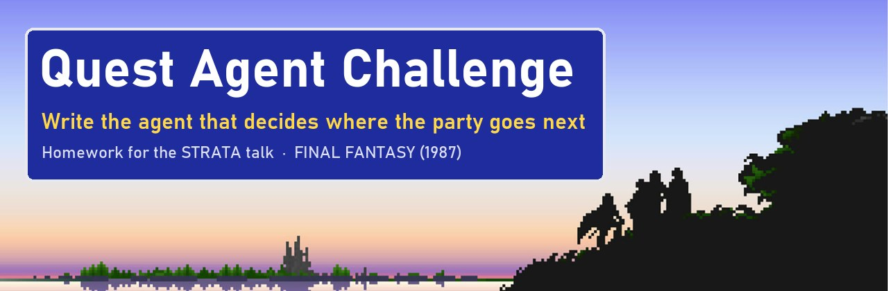
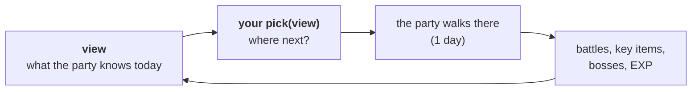
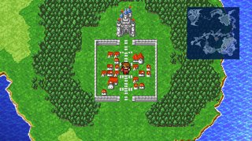
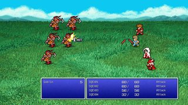
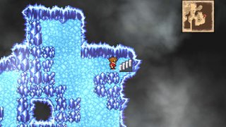
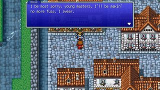
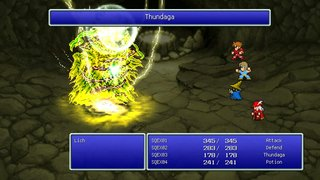
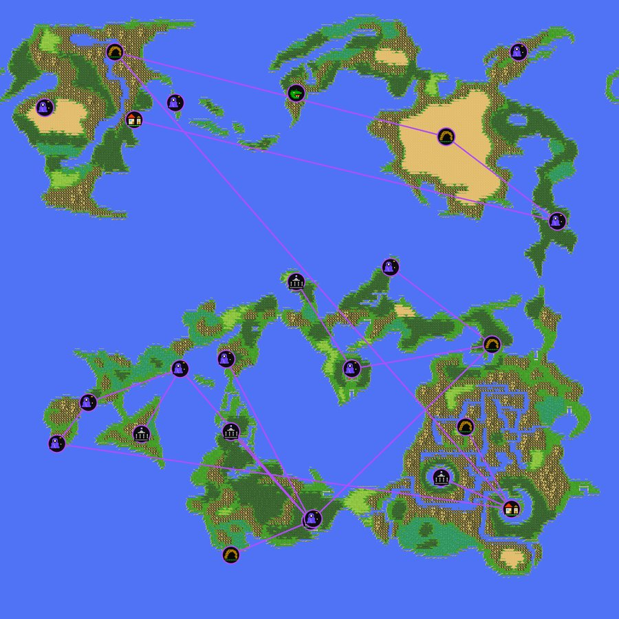
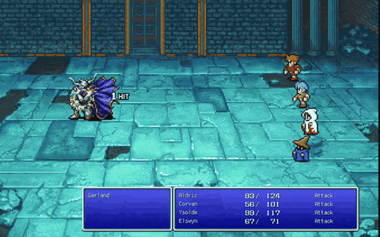
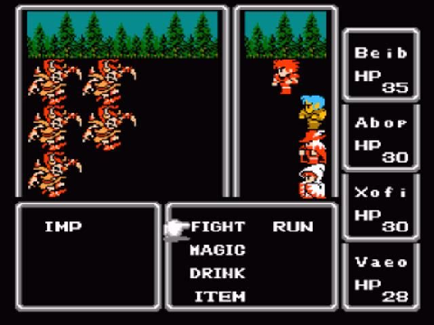

<p align="center">
  
</p>

<p align="center">
  
  
  
  
</p>

A party of four has to get through FINAL FANTASY's quest: find places, collect key items, get
strong enough for each boss, and beat the last one. **You write the agent that decides where the
party goes each day.** In the lecture, STRATA's route network made this same decision in the real
game. Here the game is small enough to play all 31 test maps in under a second.

> [!IMPORTANT]
> **What you hand in:** a screenshot of the **green check mark** ✅ that GitHub gives your fork
> when every check passes, uploaded to Canvas. Step 8 shows exactly what to screenshot.

## The three parts

| | Part | File | How it is checked |
|:-:|---|---|---|
| 1 | **Quiz:** 6 multiple-choice questions, each from a lecture slide | `quiz.py` | your letters are compared with the answers |
| 2 | **Agent:** fill in 2 `TODO`s so your party explores and finishes the quest | `my_policy.py` | your agent plays all 31 maps |
| 3 | **Hand in:** push, get the green check, screenshot it | GitHub | `grade.py` runs on every push |

You pass when all 10 checks pass: your name, the 6 answers, and 3 checks on your agent (it does
not crash, it wins the FF1 map, and it wins at least 25 of the 31 maps).



## Step by step

### Step 1. Fork the repo and turn on the grader

1. Sign in to GitHub, open **https://github.com/Al-Scripting/strata-activity**, and press **Fork**
   (top right), then **Create fork**. You now have your own copy at
   `github.com/<your-username>/strata-activity`.
2. On **your fork**, open the **Actions** tab and press
   **I understand my workflows, go ahead and enable them**. GitHub turns off the grader on new
   forks until you press this. (Only forks are graded: this starter repo's own check stays grey.)

### Step 2. Get the code on your computer

On your fork, press the green **Code** button, copy the HTTPS address, and run:

```
git clone https://github.com/<your-username>/strata-activity.git
cd strata-activity
python --version
```

You need Python 3.9 or newer. On macOS and Linux the command may be `python3`; use it everywhere
below. No Python? Install it from https://www.python.org/downloads/ (on Windows, tick **Add
python.exe to PATH**).

> [!TIP]
> The easiest way to work is **VS Code**: File → Open Folder → `strata-activity`, then
> Terminal → New Terminal. Every command below runs from that folder.

### Step 3. Run the grader once

```
python grade.py
```

You will see red ✗ lines and `NOT YET 1/10 checks`. That is expected: nothing is done yet. Every
time you finish something, run it again and watch a ✗ turn into a ✓.

### Step 4. Watch an agent get stuck

```
python run.py --policy baselines:KeyChaser --map ff1 --show
```

Each line is one day: the day, the party's level, where the party is, and what happened.

```
day   1  LV  2  Cornelle Fields        Reached Cornelle Fields. Battles: +60 EXP each.
day   9  LV  3  Fiend Shrine           Reached Fiend Shrine. Boss beaten: +231 EXP each. Got: Lute, Bridge.
```

Scroll up to the last line with `Got:` and look at what KeyChaser does after it. You need this
for quiz question 6.

### Step 5. Answer the quiz

Open `quiz.py`. Write your name, then put one letter in each answer:

```python
NAME = "Ada Lovelace"
Q1 = "b"
```

Each question names the slide its answer is on. Run `python grade.py`: correct answers turn green.

### Step 6. Write your agent

Open `my_policy.py`. The agent already knows how to grind for EXP; it is missing the part from
the lecture that matters most, **exploring**.

| `TODO` | What to write | From the lecture |
|---|---|---|
| 1 | Add a place to `targets` when you have **not visited** it yet, or it is a **story place** (`"dungeon"`, `"event"`, `"gate"`) you have **not cleared** | exploration vs exploitation |
| 2 | Remove the `#` from the 4 lines given, so the agent walks to the **nearest** target | the route network picks a place, the executor walks there |

Watch your agent play the FF1 map:

```
python run.py --map ff1 --show
```

### Step 7. Grade it

```
python grade.py
```

When everything is done you see this:

```
  ✓  Wins the FF1 map: day 223 of 350
  ✓  Wins at least 25 of the 31 test maps: 31 won, 283.1 days on average

   PASSED   10/10 checks   Ada Lovelace   2026-12-01 18:30 UTC
```

### Step 8. Push, and hand in the green check

```
git add quiz.py my_policy.py
git commit -m "My quest agent"
git push
```

GitHub runs `grade.py` on your push (about 30 seconds). Then:

1. Open **your fork** on GitHub and press the **Actions** tab.
2. Open the newest run, **My quest agent**. It shows a green ✅ next to **grade.py** and a summary
   that starts with **✅ PASSED: your name**.
3. Take a screenshot of that page (Windows: <kbd>Win</kbd>+<kbd>Shift</kbd>+<kbd>S</kbd>,
   macOS: <kbd>Cmd</kbd>+<kbd>Shift</kbd>+<kbd>4</kbd>) with the **green check, your name and
   PASSED** in it, and upload it to Canvas.

A red ❌ instead? Open the run: the summary lists which checks failed. Fix them, push again.

> [!NOTE]
> **No Python or git?** You can do Steps 5 and 6 on GitHub's website: open the file on your fork,
> press the pencil ✏️, edit, and press **Commit changes**. Every commit is graded, so the Actions
> tab shows your result. You only miss watching the agents play.

## What you will use from the lecture

| Slide | Where you use it |
|---|---|
| Reinforcement learning | Q1. Your agent sees a state (`view`) and picks an action (a place). |
| Proximal Policy Optimization (PPO) | Q2 |
| Two networks and an executor | Q3. `pick()` is the route network's job: where next? |
| How the route network chooses | Q4, Q6 and TODO 1: explore new places, don't only exploit what you know |
| Progress over the run | Q5. When a boss turns you away, `farm()` grinds for EXP, like STRATA's agent |

## The game

Every day you pick one neighbouring place and the party walks there.

| | Place | What happens |
|---|---|---|
|  | **town** | Safe. After a wipe, the party wakes up in the last town it visited. Some towns hand over a key item. |
|  | **field** | 10 random battles: EXP. |
|  | **dungeon** | 10 battles, plus a boss and key items the first time. |
|  | **event** | A person who trades: bring the key items they want and they give you new ones. |
|  | **gate** | A boss. It turns you away until you have its key items and its level. The last gate wins the map. |

- **Turned away:** going to a place you lack key items for (or a boss you are too weak for) costs a day, and you stay where you were.
- **Wiped:** entering a field or dungeon below its level sends you back to the last town and costs 3 extra days.
- **Fog of war:** you only see the places you have visited and their neighbours.
- **Levels:** FINAL FANTASY's own level table; a battle's EXP is shared by the 4 characters.

There are 31 test maps. `ff1` is FINAL FANTASY's quest line: 42 places, from Cornelle Castle to
Chaos, in 350 days. The other 30 (`seed:1` to `seed:30`) are generated, with 4 to 6 regions and 150
days per region. Watch any of them: `python run.py --map seed:7 --show`.

<p align="center">
  
  <br><sub>The <code>ff1</code> map's 42 places at their real spots on FINAL FANTASY's world map.</sub>
</p>

<p align="center">
  
  <br><sub>STRATA's agent beating Garland, the first boss, in the real game (19 November).</sub>
</p>

<details>
<summary><b>Everything <code>view</code> gives your agent</b></summary>

```python
class Policy:
    def __init__(self):          # a new Policy for every map: keep memory in self
        pass

    def pick(self, view):        # return one of view.neighbors
        ...
```

- `view.here`, `view.neighbors`: where the party is, and where it can walk today.
- `view.level`, `view.exp`, `view.exp_next`, `view.items`, `view.day`, `view.days_left`.
- `view.known[name]`: a `PlaceInfo` for each place you have seen, with `.kind`, `.level`,
  `.visited`, `.cleared`, `.ok` (you can enter it right now), `.blocked_by` (why not, e.g.
  `["item:Crown", "level:10"]`), `.gives` (its key items, once you have them) and `.exp` (EXP per
  visit, once you have been there).
- `view.path_to(name)`: the shortest path through places you can enter, or `None`.
- `view.final`: the last boss's name once you have seen it.
- `farm(view)` in `baselines.py`: walks to the place with the most EXP the party can survive, and
  fights there.

Try it in Python:

```
python -i -c "from quest import Quest; q = Quest.load('ff1'); v = q.view()"
>>> v.neighbors
>>> v.known['Fiend Shrine']
>>> v.path_to('Pravok Port')
```
</details>

<details>
<summary><b>Want more? (not graded)</b></summary>

- **Fewer days.** The finished starter takes 283.1 days on average. Can you plan a shorter route?
- **The learning agent.** `learner.py` has no hand-written rule: it scores each place with six
  weighted features and learns the weights by playing training maps (an evolution strategy).
  Run `python learner.py`, then `python run.py --policy learner:LearnedPolicy`. Add a feature,
  train longer (`--iters 200 --maps 20`), or replace it with Q-learning.
- **Make a map** in `maps/` that beats a classmate's agent. It must still pass `python test_quest.py`.
</details>

## Troubleshooting

| Problem | Fix |
|---|---|
| `python` is not found | Try `python3`, or `py` on Windows. Reinstall Python with **Add to PATH** ticked. |
| `No module named 'quest'` | Run the commands from inside the `strata-activity` folder. |
| `'X' is not a neighbour of 'Y'` | `pick` must return one of `view.neighbors`; use `view.path_to(target)[0]`. |
| A line in `grade.py` says `does not load` | It names the file and line with the typo, often a missing quote. |
| No run in the Actions tab | Step 1.2: enable the workflows on your fork, then push again. |
| `git commit` asks who you are | `git config --global user.name "Your Name"` and `git config --global user.email "you@example.com"` |
| `git push` asks for a password | GitHub needs a sign-in, not your password: in VS Code use Source Control → **Sync Changes**, which signs you in. |
| Red ❌ on GitHub but `PASSED` on your computer | You did not push your latest change: `git status`, then Step 8 again. |

<details>
<summary><b>Where the numbers come from</b></summary>



| Number | Source |
|---|---|
| Level table | FINAL FANTASY (NES), from Disch's FF1 disassembly |
| EXP of each place | the mean EXP of one battle in that area of the NES game, times 10 battles, shared by 4 |
| Boss EXP | the boss's EXP in the NES game, shared by 4 |
| Boss and dungeon levels | the recommended levels in RPGSite's FF1 boss guide (A. Donaldson, 2021) |
| Generated maps | a battle at level L pays 6 × L², a fit to FF1's areas |

`python test_quest.py` checks the game itself (instructors).
</details>

---

<sub>Made for the STRATA lecture, Code & Sorcery Lab, Ontario Tech University. FINAL FANTASY is a
trademark of Square Enix; its screenshots here are used for teaching. Place names follow STRATA's
own spelling.</sub>
